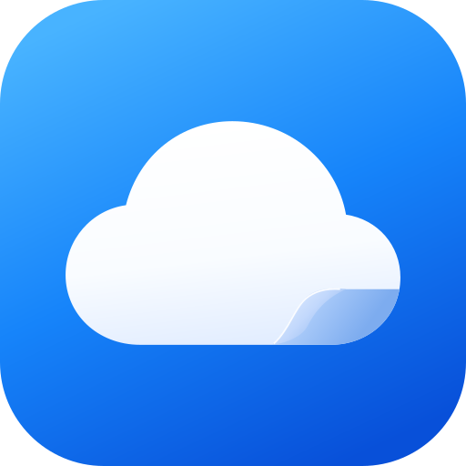

<p align="center">
  
</p>

<h1 align="center">TeleDrive</h1>

<p align="center"><strong>Everything you keep, in one place.</strong></p>
<p align="center">A native Android home for your files, photos and music — stored in your own private Telegram channels.</p>

<p align="center">
  <a href="https://github.com/jntynho/TG-Drive/releases/latest"></a>
  <a href="https://github.com/jntynho/TG-Drive/actions/workflows/release-no-secrets.yml"></a>
  <a href="#download"></a>
  <a href="https://github.com/jntynho/TG-Drive/releases"></a>
</p>

<p align="center">
  <a href="#download">Download</a> ·
  <a href="#features">Features</a> ·
  <a href="#getting-started">Getting started</a> ·
  <a href="#documentation">Documentation</a> ·
  <a href="https://github.com/jntynho/TG-Drive/issues">Report an issue</a>
</p>

## Download

<p align="center">
  <a href="https://github.com/jntynho/TG-Drive/releases/latest/download/tg-drive-arm64-v8a.apk"></a>
</p>
<p align="center">
  <a href="https://github.com/jntynho/TG-Drive/releases/latest/download/tg-drive-armeabi-v7a.apk"></a>
</p>

| Your device | Choose |
| --- | --- |
| Most modern Android phones and tablets | **[ARM64 · arm64-v8a](https://github.com/jntynho/TG-Drive/releases/latest/download/tg-drive-arm64-v8a.apk)** |
| Older devices running a 32-bit ARM system | [ARM32 · armeabi-v7a](https://github.com/jntynho/TG-Drive/releases/latest/download/tg-drive-armeabi-v7a.apk) |

All variants require **Android 8.0 or later** and install independently. Download **one `.apk`**; no ZIP extraction or split-APK installer is needed. The buttons always target the latest published release.

Only these two ARM standalone APKs are published. Universal, x86, x86_64 and AAB release builds are disabled in the release workflow. GitHub's automatic source ZIP/TAR downloads contain source code; choose an APK to install.


**Installation:** these releases install as **TeleDrive** (`app.tgdrive.next`) alongside the original TG Drive. Keep the old app and its data; sign in again in Next. Subsequent Next releases use the pinned Next certificate. See the [release guide](docs/RELEASING.md).

## Features

The Android rebuild uses the real [DriveInfinity](https://github.com/ZHINFINITY/DriveInfinity) engine and presentation modules, adapted to TG Drive's dark visual system, Solar Linear icons, Sand library dashboard and four-tab navigation.

| Area | Available options |
| --- | --- |
| Home & files | Recent files, size/type overview, folders, favorites, hidden/archived collections, bulk actions, search and Markdown notes |
| Gallery & Audio | Photo/video grids and albums, search/sort, immersive previews, music artwork, Media3 streaming and playback preferences |
| Storage channels | Discover, create, switch, rename and delete owned private drives |
| Activity | Persistent upload/download queue, progress, pause/resume/retry/cancel, concurrency and shared Telegram cooldowns |
| Backup | Selected folders, exclusions, instant/scheduled backup, Wi-Fi/charging rules and file-size limits |
| Privacy & recovery | Optional file/thumbnail encryption, passphrase-protected key backup, device app lock and screenshot blocking |
| Storage & advanced | Cache budget, cleanup, Trash/restore/retention, proxies/failover, notifications, appearance/density and optional updates |

### Four tabs. One library.

| Home | Gallery | Audio | Settings |
| --- | --- | --- | --- |
| Dashboard, recent files and shortcuts | Photos/videos, albums and thumbnail grids | Songs/recordings with available artwork | Account/drives, backup, storage, security and the other reference settings |

The complete mapping is in [the rebuild inventory](docs/REBUILD-PARITY.md). Earlier 0.x design/upload documents describe the retired engine and are retained as history.

## Getting started

1. Install an APK matching your phone.
2. Enter your Telegram phone number and follow Telegram’s sign-in prompts. Official releases include TeleDrive’s application identity; code delivery, password/email checks and QR availability are controlled by Telegram.
3. Choose or create an owned private TG Drive channel.
4. Add files or share documents from another Android app. Follow their progress in Activity. Enable folder backup or encryption only after choosing the relevant preferences and saving recovery material.

No separate storage server is required. Telegram still controls account limits, connection speed and server-requested waiting periods; Android can defer background work.

## How uploading works

TDLib sends the document and its manifest caption in the same message directly to the chosen private channel. The caption records the file/folder identity and allows the index to be rebuilt. Large/encrypted files retain the reference multipart, streaming and key-recovery paths. Two upload slots start originals without an artificial per-file delay. A separate server-copy lane and independent downloads share a persisted Telegram cooldown; changing the destination does not remove server limits. Selected provider URIs and queued work survive process recreation.

The **Add** sheet includes original photos/videos, document scanning, private camera capture, folders, local Google Takeout ZIP import, and server-side copies from Telegram chats. Name conflicts offer Replace / Keep both / Skip. A shared file sheet supports downloads, offline protection, sharing, stars, rename, move, Telegram links and Trash. Scanning needs supported Google Play services; Google Photos import uses downloaded Takeout exports, without a Google login inside TeleDrive.

Read the [transfer and playback notes](docs/TRANSFER-AND-PLAYBACK.md) for the scheduling policy, recovery behavior, feature requirements and verification limits.

## Moving from the original app

TG Drive Next is a separate installation with a new signing identity. It does not overwrite `app.tgdrive`, clear its files, or read its private local session/index. Keep the original app for its existing Saved Messages library and old vaults. Sign in again in Next to use private-channel drives; restore the matching encryption recovery material when opening encrypted channel content.

The previous-library compatibility reader only reads data within the current installation's own namespace. It cannot bypass Android's isolation to import the other app's private data.

Ordinary channels are not end-to-end encrypted. Keep encryption recovery material outside your phone and a separate copy of important data. Read [the security boundaries](docs/SECURITY.md) and [current validation status](docs/TESTING.md).

## Documentation

| Guide | What you will find |
| --- | --- |
| [Rebuild inventory](docs/REBUILD-PARITY.md) | DriveInfinity feature mapping, upgrade behavior and validation |
| [Connection troubleshooting](docs/CONNECTION_TROUBLESHOOTING.md) | Telegram setup and connection diagnostics |
| [Security](docs/SECURITY.md) | Encryption, credentials, sharing and recovery boundaries |
| [Testing](docs/TESTING.md) | Checks, device coverage and remaining validation |
| [Builds and releases](docs/RELEASING.md) | APK variants, signing, CI and upgrade checks |
| [Upload audit · Arabic](docs/UPLOAD-0.10.ar.md) | Removed delays, source integrity, recovery and Telegram limits |
| [Upload pipeline](docs/UPLOAD-0.8.md) | Parallel content preparation and coordinated publication |
| [UI/UX corrections · Arabic](docs/UI-UX-0.9.ar.md) | The 0.9 audit corrections and practical limits |
| [UI review and fixes · Arabic](docs/UI-UX-SKILL-REVIEW.ar.md) | The full interface review, applied corrections and validation |
| [Solar and approved layouts · Arabic](docs/SOLAR-0.11.ar.md) | Icon sources, semicircle dashboard and grouped Activity |
| [Telegram and Gallery follow-up · Arabic](docs/reviews/TELEGRAM-GALLERY-STARTUP-FOLLOWUP.ar.md) | Telegram actions, pinch stability, startup and the restored icon |
| [Hidden lock and sign-in · Arabic](docs/reviews/HIDDEN-LOCK-AND-SIGN-IN.ar.md) | In-app input, local PIN protection, recovery and security boundaries |
| [Startup preparation · Arabic](docs/reviews/STARTUP-PREPARATION.ar.md) | Bounded local preparation, animation probes and manual performance profiling |
| [Saved audit corrections · Arabic](docs/reviews/AUDIT-IMPLEMENTATION.ar.md) | Navigation, Audio, Gallery, video, Telegram actions and validation limits |
| [App icon artwork](docs/brand/README.md) | Editable SVG layers, adaptive sizing and system-themed icons |

## Build from source

Use **JDK 21**, Android SDK **37.0**, Build Tools **37.0.0**, and the checked-in Gradle wrapper. Set `ANDROID_HOME`, or add `sdk.dir` to an ignored `local.properties` file.

```sh
git clone https://github.com/jntynho/TG-Drive.git
cd TG-Drive
./gradlew --max-workers=1 assembleDebug
```

The debug APK is written to `app/build/outputs/apk/debug/app-debug.apk`.

<details>
<summary><strong>Validation, release builds and Telegram application credentials</strong></summary>

```sh
./gradlew --max-workers=1 :shared:allTests :app:testDebugUnitTest :app:lintDebug :app:assembleDebugAndroidTest
./gradlew --max-workers=1 testDebugUnitTest lintRelease assembleRelease -PsplitApks=true
npm test --prefix sharing-server
python3 scripts/generate_launcher.py --check
```

The optional sharing-service tests require Node.js 24. Native Android device tests additionally need a connected device or emulator; see [Testing](docs/TESTING.md).

Release builds use `TELEGRAM_API_ID` and `TELEGRAM_API_HASH` from GitHub Actions Secrets so users sign in with their phone number. Existing stored credentials keep priority. Debug builds exclude production values and retain manual API setup. See [application identity setup](docs/TELEGRAM_APP_CREDENTIALS.md). Never commit credential values, user sessions, login codes, passwords or signing keys.

Local release outputs are unsigned unless the Next signing configuration is supplied. The GitHub workflow verifies device tests, unit tests and release lint checks, matching APK payloads, signature/alignment and a signed installation check before publishing installable assets. It does not upload to Google Play.

</details>

## Contributing

[Report a bug](https://github.com/jntynho/TG-Drive/issues) with your app version, Android version, device architecture and steps to reproduce. Remove phone numbers, login codes, API credentials and private file details from reports and screenshots.

For code contributions, keep changes focused and run the checks relevant to the change. See [Testing](docs/TESTING.md) for the full validation guide.

## Acknowledgements

Based on [DriveInfinity](https://github.com/ZHINFINITY/DriveInfinity), originally by Mahmudul Hasan Khan (Mahmud0808 / DrDisagree), with ZHINFINITY and contributor changes, under [Apache 2.0](third_party/driveinfinity/LICENSE). The pinned source and derivative changes are recorded [here](third_party/driveinfinity/SOURCE.md).

Built with [TDLib](https://github.com/tdlib/td), [Jetpack Compose](https://developer.android.com/compose), [Media3](https://developer.android.com/media/media3) and [Tink](https://github.com/tink-crypto/tink). Interface icons use **Solar Linear by [480 Design](https://www.figma.com/community/file/1166831539721848736)**, licensed under [CC BY 4.0](https://creativecommons.org/licenses/by/4.0/). Selected SVG sources, attribution and the native-vector conversion details are in [third_party/solar](third_party/solar/SOURCE.md).

TG Drive is an independent project and is not affiliated with Telegram.

The optional liquid floating navigation imports the original [only_player](https://github.com/Kindness-Kismet/only_player) component. Its GPL-3.0 source and retained Apache-2.0 notices are documented in [third_party/only_player](third_party/only_player/SOURCE.md); these notices apply to their respective imported portions.
